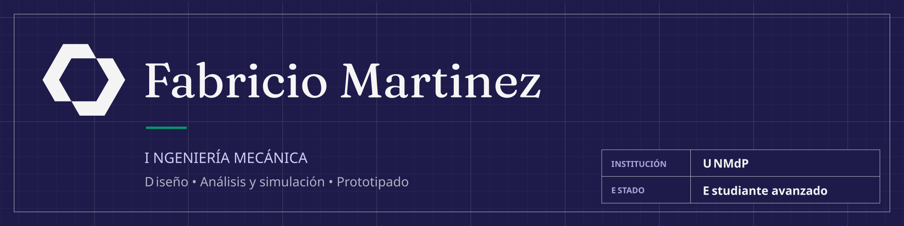
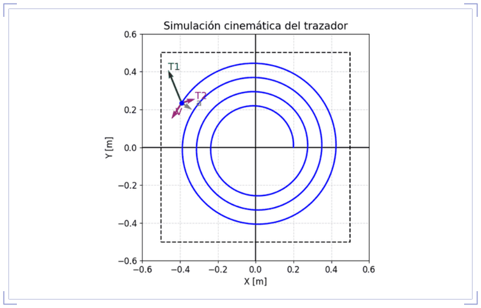
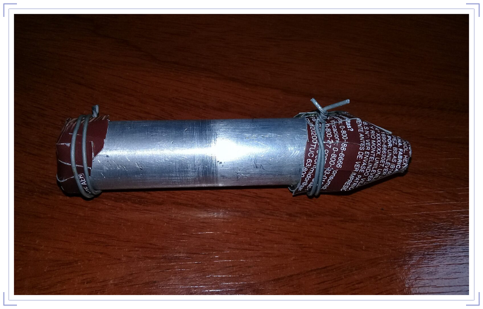
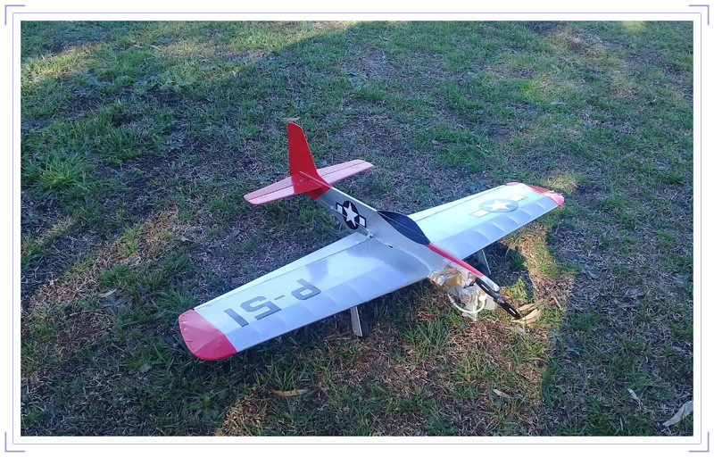

<!-- EDITAR: antes de publicar, confirmá que https://fabricio-martinez.github.io/ ya esté en línea; si no, los enlaces "Ver en el sitio" no van a abrir. -->

Soy estudiante avanzado de Ingeniería Mecánica en la Universidad Nacional de Mar del Plata. Trabajo en diseño mecánico, análisis cinemático y simulación, y me interesan la ingeniería aeroespacial y la aeronáutica.

Acá están mis proyectos con su documentación técnica. La historia completa y el CV están en mi [sitio web](https://fabricio-martinez.github.io/).

## Proyectos

<table>
  <tr>
    <td width="33%" valign="top">
      
       <b>Plotter vertical</b>
       Análisis cinemático y dinámico de un trazador sostenido por dos correas con contrapesos. Resuelto en Python y validado en Working Model 2D. Trabajo práctico en equipo.
       Python · Splines cúbicos · Working Model 2D
       <a href="https://fabricio-martinez.github.io/proyectos/plotter-vertical.html">Ver en el sitio</a> · <a href="https://github.com/Fabricio-Martinez/plotter-vertical">Repositorio</a>
    </td>
    <td width="33%" valign="top">
      
       <b>Motor cohete de combustible sólido</b>
       Diseño por prueba y error de un motor casero, de una cámara de cartón a una de aluminio.
       Cartón · Aluminio · Prueba y error
       <a href="https://fabricio-martinez.github.io/proyectos/motor-cohete-combustible-solido.html">Ver en el sitio</a> · <a href="https://github.com/Fabricio-Martinez/motor-cohete-combustible-solido">Repositorio</a>
    </td>
    <td width="33%" valign="top">
      
       <b>Mustang P-51 (U-Control)</b>
       Construcción completa de un avión de aeromodelismo a escala, en balsa y con motor a combustión, a partir de planos existentes.
       Balsa · Entelado · Motor a combustión
       <a href="https://fabricio-martinez.github.io/proyectos/mustang-p51-ucontrol.html">Ver en el sitio</a> · <a href="https://github.com/Fabricio-Martinez/mustang-p51-ucontrol">Repositorio</a>
    </td>
  </tr>
</table>

## Herramientas

| Área | Herramientas |
| :-- | :-- |
| Diseño y CAD | Autodesk Inventor · FreeCAD · AutoCAD |
| Análisis y simulación | Python · Excel · Working Model 2D · Blender |
| Documentación técnica | Word (norma IEEE) · PowerPoint · Affinity |

## Formación y actividad

- **Ingeniería Mecánica**, Universidad Nacional de Mar del Plata, desde 2020.
- **Ayudante de cátedra** en Física Básica, UNMdP, desde 2022.

## Intereses

Exploración espacial · Aeronáutica · Tecnología de defensa

## Contacto

[Sitio web](https://fabricio-martinez.github.io/contacto.html) · [LinkedIn](https://www.linkedin.com/in/fabriciomateomartinez/)
